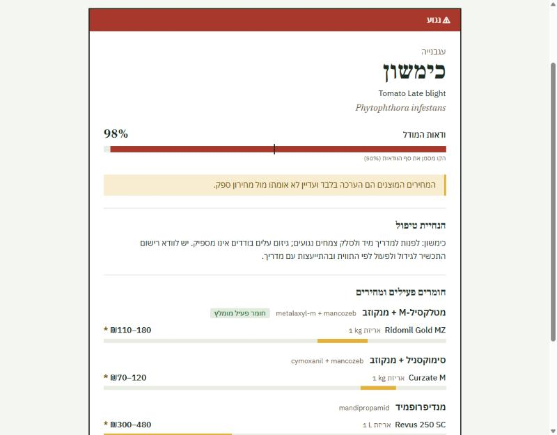
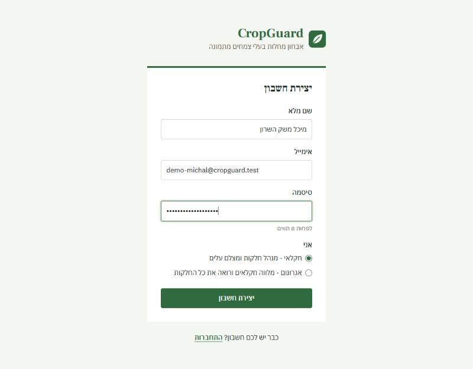
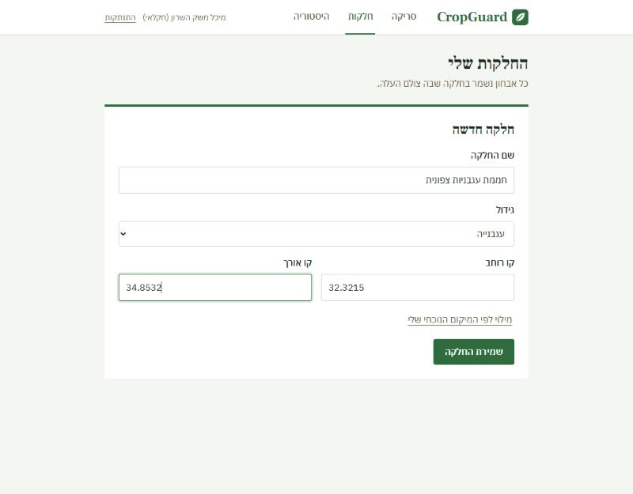
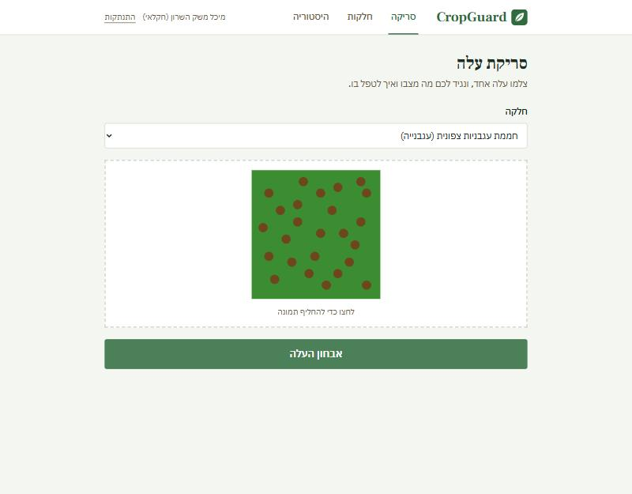
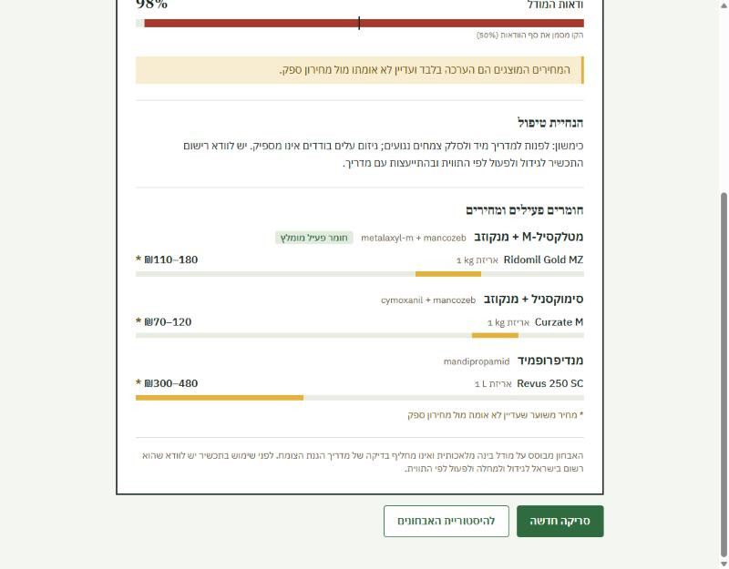
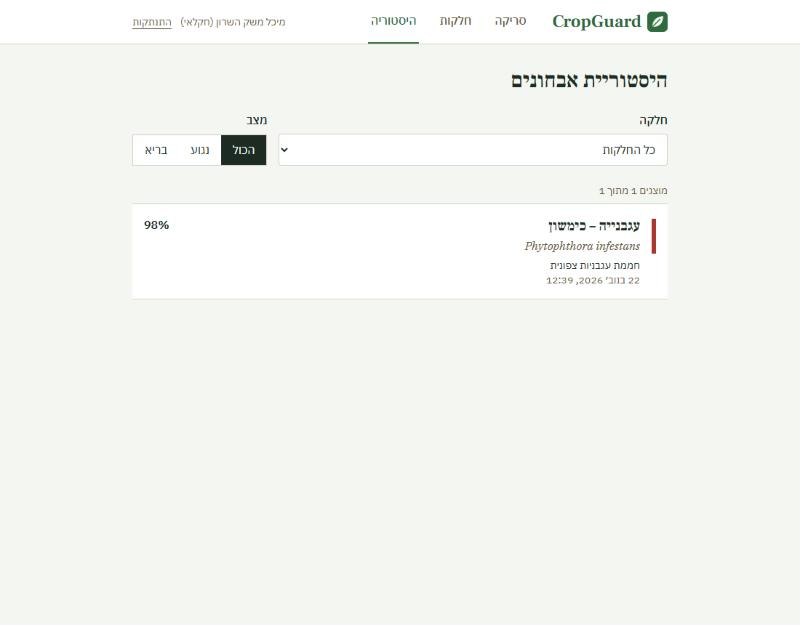
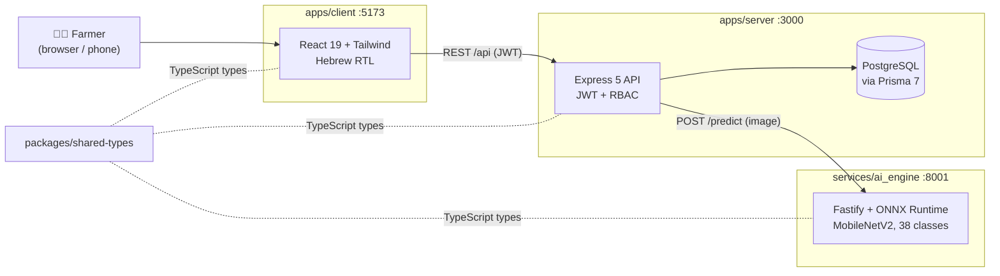

# CropGuard 🌿

**מערכת לאבחון מחלות בעלי צמחים מתמונה, לחקלאים ולאגרונומים בישראל.**

חקלאי מצלם עלה בשדה, ותוך שנייה מקבל בעברית: מה המחלה (גם בשם המדעי), עד כמה המודל בטוח,
איך לטפל, אילו חומרים פעילים מקובלים, וכמה עולים התכשירים בשקלים. כל אבחון נשמר בהיסטוריה של החלקה.

<p align="center">
  
</p>

---

## תוכן עניינים

1. [מה המערכת עושה](#מה-המערכת-עושה)
2. [ארכיטקטורה בקצרה](#ארכיטקטורה-בקצרה)
3. [הרצה מהירה](#הרצה-מהירה)
4. [מבנה המאגר](#מבנה-המאגר)
5. [טכנולוגיות](#טכנולוגיות)
6. [בדיקות](#בדיקות)
7. [מגבלות ידועות](#מגבלות-ידועות)
8. [מקורות וקרדיטים](#מקורות-וקרדיטים)

**מסמכים נוספים:**
- [docs/ARCHITECTURE.md](docs/ARCHITECTURE.md): ארכיטקטורה מלאה, תזרימי נתונים, מודל הנתונים ואבטחה.
- [docs/DEFENSE.md](docs/DEFENSE.md): הכנה לבחינה, כולל שאלות ותשובות, נימוק לכל החלטה הנדסית ותסריט הדגמה.

---

## מה המערכת עושה

**המסע של החקלאי:**

| | שלב | מסך |
|---|---|---|
| 1 | הרשמה כחקלאי או אגרונום |  |
| 2 | יצירת חלקה: שם, גידול ומיקום (אפשר מה-GPS של הטלפון) |  |
| 3 | צילום או העלאה של עלה |  |
| 4 | אבחון AI חי בעברית: שם המחלה, השם המדעי, ודאות, הנחיית טיפול, חומרים פעילים ומחירים בשקלים |  |
| 5 | שמירה בהיסטוריה, עם סינון לפי חלקה ומצב |  |

**היכולות:**
- זיהוי **38 מצבים**, כלומר 26 מחלות ו-12 מצבי "בריא", ב-**14 גידולים**: עגבנייה, תפוח אדמה, פלפל, תירס, גפן, תפוח, תפוז ועוד.
- **עברית מלאה ו-RTL**: שמות מחלות וחומרים פעילים בעברית, לצד השם באנגלית והשם המדעי (למשל *Phytophthora infestans*).
- **המלצות טיפול ומחירים**: חומרים פעילים לכל מחלה, ומוצרים מסחריים עם טווח מחירים בש"ח.
- **הרשאות לפי תפקיד (RBAC)**: חקלאי רואה רק את שלו, ואגרונום ומנהל רואים את כל החקלאים.
- **מותאם לטלפון**: ניווט תחתון, צילום ישיר, ומילוי מיקום החלקה מה-GPS.

---

## ארכיטקטורה בקצרה

שלוש מערכות נפרדות, שמדברות ב-HTTP/JSON, וטיפוסים משותפים ב-TypeScript:



| מערכת | אחריות | יודעת על |
|---|---|---|
| **AI Engine** | תמונה → מחלה + ודאות. בלי משתמשים ובלי מסד | רק המודל |
| **Core Server** | משתמשים, הרשאות, חלקות, המלצות, מחירים, היסטוריה | מסד הנתונים + כתובת ה-AI |
| **Client** | ממשק בעברית | רק ה-API של השרת |

**הנתיב המרכזי** (`POST /api/diagnose`): הלקוח שולח תמונה, והשרת בודק הרשאה לחלקה ומעביר את התמונה ל-AI.
ה-AI מחזיר תווית וודאות. השרת מוסיף המלצה ומחירים מ-PostgreSQL, שומר את האבחון ומחזיר תשובה בעברית.
התרשימים המלאים נמצאים ב-[docs/ARCHITECTURE.md](docs/ARCHITECTURE.md).

---

## הרצה מהירה

**דרישות:** Node.js 20+ (נבדק עם 25), ו-PostgreSQL. אפשר להשתמש ב-`prisma dev`, שלא דורש התקנה.

```powershell
# 1. התקנה (פעם אחת)
npm install

# 2. מסד נתונים מקומי (פעם אחת; אחר כך: npx prisma dev start cropguard)
cd apps/server
npx prisma dev --detach --name cropguard     # מדפיס כתובת postgres://...
copy .env.example .env                       # למלא DATABASE_URL ו-JWT_SECRET
npm run db:migrate
npm run db:seed
cd ../..
```

```powershell
# 3. שלוש המערכות - כל אחת בטרמינל נפרד
npm run dev:ai       # http://localhost:8001  (דף בדיקה + /docs)
npm run dev:server   # http://localhost:3000/api
npm run dev:client   # http://localhost:5173  ← לפתוח בדפדפן
```

```powershell
# 4. בדיקת מקצה לקצה חיה מול שלוש המערכות
npm run e2e
```

| פקודה | מה היא עושה |
|---|---|
| `npm run dev:ai` / `dev:server` / `dev:client` | הרצת כל מערכת במצב פיתוח |
| `npm test` | כל הבדיקות בכל החבילות |
| `npm run typecheck` | בדיקת טיפוסים בכל החבילות |
| `npm run lint` | בדיקת קוד (oxlint) |
| `npm run build` | בנייה לייצור |
| `npm run e2e` | מסע חקלאי מלא מול המערכות הרצות (אפשר גם עם צילום: `npm run e2e -- leaf.jpg`) |

---

## מבנה המאגר

```
CropGuard/                     monorepo (npm workspaces)
├── services/
│   └── ai_engine/             שירות ה-AI: Fastify + ONNX Runtime + sharp
│       ├── src/               שרת, טעינת מודל, עיבוד תמונה, תוויות
│       ├── model/             cropora_model.onnx (רץ), .keras (מקור), labels-38.txt
│       ├── public/            דף בדיקה בעברית
│       └── tools/             convert_to_onnx.py - המרה חד-פעמית (הקובץ היחיד ב-Python)
├── apps/
│   ├── server/                שרת הליבה: Express + Prisma + PostgreSQL
│   │   ├── src/               routes, auth, services, i18n
│   │   └── prisma/            schema, migrations, seed + נתוני מחירים והמלצות
│   └── client/                React + Vite + Tailwind, עברית ו-RTL
│       └── src/               pages, components, api, auth
├── packages/
│   └── shared-types/          טיפוסי ה-API, משותפים לשלוש המערכות
├── scripts/
│   └── e2e-journey.mjs        בדיקת מקצה לקצה חיה
└── docs/                      ארכיטקטורה, הכנה לבחינה, צילומי מסך
```

לכל חבילה יש README משלה עם הפרטים:
[ai_engine](services/ai_engine/README.md) · [server](apps/server/README.md) · [client](apps/client/README.md) · [shared-types](packages/shared-types/README.md)

---

## טכנולוגיות

| שכבה | טכנולוגיה | למה |
|---|---|---|
| שפה | **TypeScript** בכל המערכות | טיפוסים משותפים מקצה לקצה |
| AI | **ONNX Runtime** (onnxruntime-node), **sharp** | הרצת המודל ב-Node בלי Python בזמן ריצה |
| AI API | **Fastify 5** + Swagger | מהיר, סכמות JSON מובנות, תיעוד אוטומטי |
| שרת | **Express 5**, **zod 4** | Express 5 מטפל בשגיאות async; zod מאמת כל קלט |
| מסד | **PostgreSQL** + **Prisma 7** | טיפוסים מהסכמה, מיגרציות מנוהלות |
| אבטחה | **JWT** (HS256), **bcrypt**, rate limit | אימות stateless, גיבוב סיסמאות, הגנה מניחוש |
| לקוח | **React 19**, **Vite 8**, **Tailwind 4**, React Router | פיתוח מהיר, RTL עם מאפיינים לוגיים |
| בדיקות | **Vitest**, Supertest, Testing Library | אותו כלי בכל החבילות |
| איכות | `tsc` strict, **oxlint** | בדיקת טיפוסים ובדיקת קוד, כולל React Hooks ונגישות |

---

## בדיקות

**153 בדיקות אוטומטיות**, ועוד בדיקת מקצה לקצה חיה:

| חבילה | בדיקות | מה נבדק |
|---|---|---|
| `services/ai_engine` | 27 | המודל האמיתי מול ערכי ייחוס מ-Keras, קודי שגיאה, עיבוד תמונה |
| `apps/server` | 79 | כל ה-routes מול PostgreSQL אמיתי, RBAC, AI מדומה (כולל תקלות), לקוח ה-AI, המילון העברי |
| `apps/client` | 47 | המסכים האמיתיים עם fetch מדומה: התחברות, סריקה, חלקות, היסטוריה, כרטיס התוצאה |
| `npm run e2e` | 21 בדיקות | מסע חקלאי מלא מול שלוש המערכות הרצות, כולל בדיקת אבטחה |

בדיקות השרת צריכות מסד בדיקות נפרד (`TEST_DATABASE_URL`), כי הן מוחקות בו נתונים.
פרטים ב-[apps/server/README.md](apps/server/README.md).

---

## מגבלות ידועות

ההגבלות כתובות כאן בכנות, ומפורטות יותר ב-[docs/DEFENSE.md](docs/DEFENSE.md#מגבלות-ומה-הייתי-עושה-הלאה):

- **המחירים הם ערכי דוגמה, לא מחירון אמיתי.** כל המחירים מסומנים `isVerified: false`, והממשק מציג עליהם אזהרה.
- **החומרים הפעילים הם מידע כללי משירותי הדרכה, לא המלצת ריסוס.** יש לוודא רישום בישראל לכל גידול.
- **דיוק המודל לא נמדד אצלנו.** המודל אומן על PlantVillage, שבו עלים בודדים על רקע נקי, וצילומי שדה אמיתיים עלולים לתת תוצאות פחות טובות.
- **תמונות העלים נשמרות בדיסק**, ואין עדיין נתיב מאובטח להצגה שלהן בהיסטוריה.

---

## מקורות וקרדיטים

- **המודל:** MobileNetV2 שעבר fine-tuning. מקור: [Muhammad-Hassan12/Plant-Disease-Detector](https://github.com/Muhammad-Hassan12/Plant-Disease-Detector),
  רישיון MIT, commit `f6165bd9`, קובץ `model_4_mobilenet_finetuned.keras` (SHA-256 `08f285af…b325f`).
  המודל הומר ל-ONNX בפרויקט הזה, ונבדק שהתוצאות שלו זהות.
- **הנתונים:** PlantVillage, 38 מחלקות.
- **הנחיות הטיפול:** מבוססות על שירותי הדרכה חקלאית (University of Minnesota Extension, NC State Extension, Clemson HGIC ועוד).
- **גופנים:** Frank Ruhl Libre, IBM Plex Sans Hebrew ו-IBM Plex Serif (רישיון OFL).
