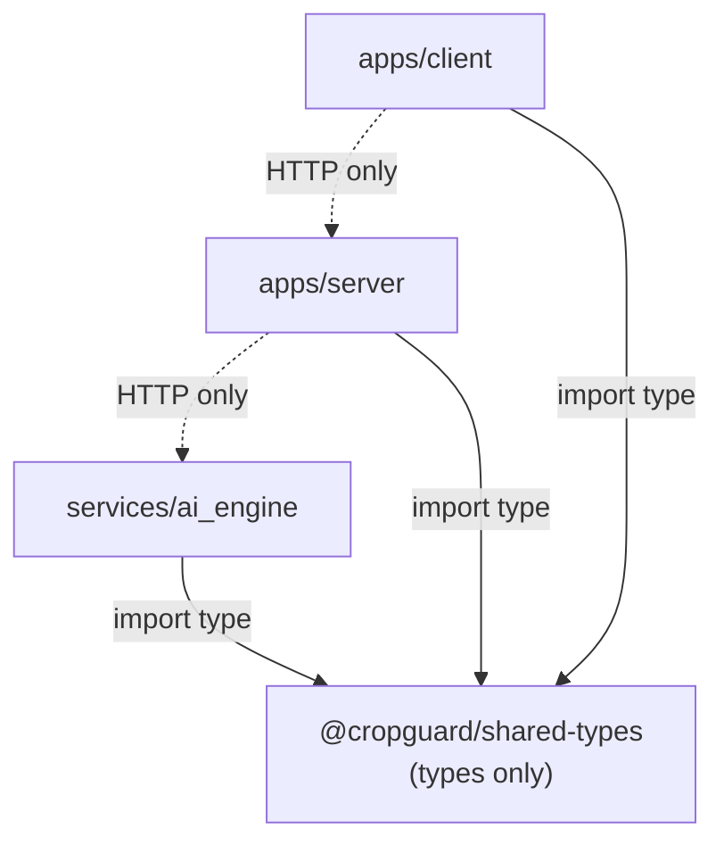
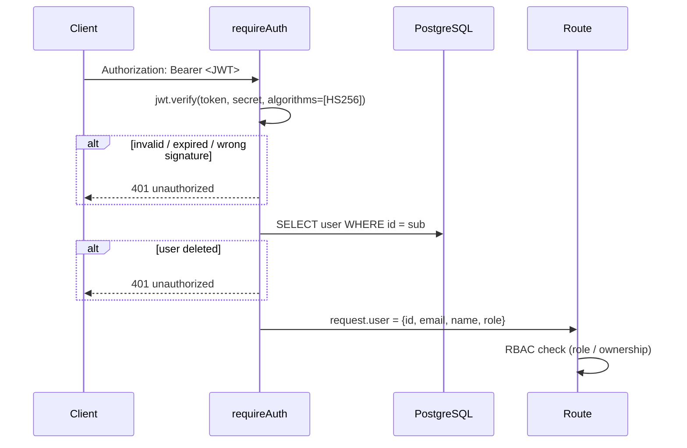
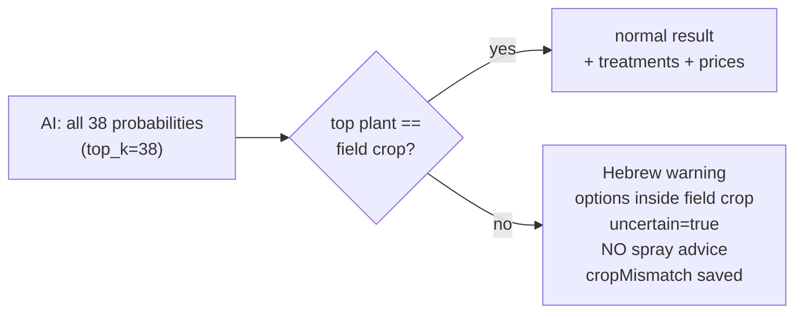
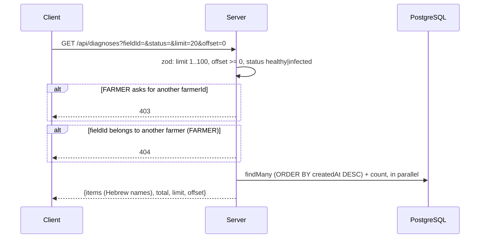
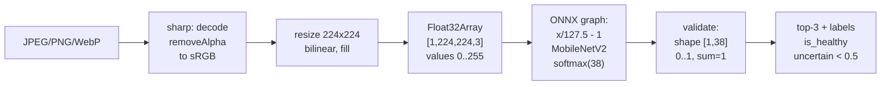
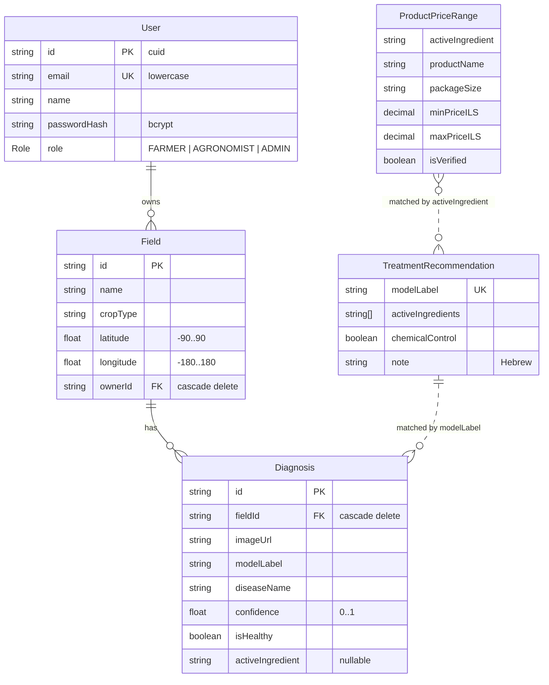
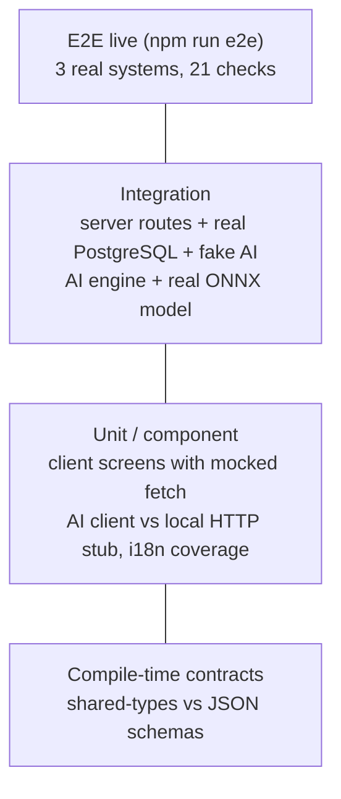

# ארכיטקטורה ותזרימי נתונים - CropGuard

המסמך מסביר איך המערכת בנויה, למה היא בנויה כך, ואיך הנתונים זורמים בה.
כל תיאור כאן תואם לקוד; הפניות לקבצים מופיעות לאורך המסמך.

## תוכן עניינים

1. [עקרונות](#1-עקרונות)
2. [הרכיבים](#2-הרכיבים)
3. [ה-Monorepo ותלויות](#3-ה-monorepo-ותלויות)
4. [תזרימי נתונים](#4-תזרימי-נתונים)
5. [צינור ה-AI](#5-צינור-ה-ai)
6. [מודל הנתונים](#6-מודל-הנתונים)
7. [אבטחה](#7-אבטחה)
8. [טיפול בשגיאות](#8-טיפול-בשגיאות)
9. [עברית ו-RTL](#9-עברית-ו-rtl)
10. [הגדרות ופורטים](#10-הגדרות-ופורטים)
11. [אסטרטגיית הבדיקות](#11-אסטרטגיית-הבדיקות)

---

## 1. עקרונות

| עיקרון | איך הוא מיושם |
|---|---|
| **הפרדת אחריות** | שלוש מערכות, ולכל אחת תפקיד אחד. ה-AI לא מכיר משתמשים, והלקוח לא מכיר את ה-AI ולא את המסד. |
| **חוזים מוקלדים** | כל מבני הבקשות והתשובות מוגדרים פעם אחת ב-`packages/shared-types`. שינוי בחוזה שובר את הקומפילציה בכל מי שמשתמש בו. |
| **לא סומכים על קלט** | כל קלט מאומת: zod בשרת, סכמות JSON ב-Fastify. גם התשובה של שירות ה-AI נבדקת, כי שירות חיצוני הוא גבול אמון. |
| **כשל בטוח** | מודל שלא נטען מחזיר 503, ולעולם לא תחזית מזויפת. כשל ב-AI לא שומר שום דבר. |
| **תלויות מוזרקות** | השרת והשירות נבנים כ"מפעל" (`createApp`, `buildApp`) שמקבל את התלויות מבחוץ. כך אפשר לבדוק עם AI מדומה. |

---

## 2. הרכיבים

### AI Engine - `services/ai_engine` (פורט 8001)

- **אחריות:** מקבל תמונה ומחזיר מחלה, ודאות ו-3 תחזיות מובילות. אין בו משתמשים, מסד נתונים או מחירים.
- **טכנולוגיה:** Fastify 5, onnxruntime-node, sharp.
- **נקודות קצה:** `POST /predict`, `GET /health`, `GET /docs` (Swagger), ו-`GET /` (דף בדיקה בעברית).
- **טעינה:** המודל נטען **פעם אחת בעליית השרת**, ועובר "חימום" בהרצה על תמונה ריקה (`src/modelLoader.ts`).
  אם הטעינה נכשלת, השירות עדיין עולה: `/health` מחזיר `degraded`, ו-`/predict` מחזיר 503.

### Core Server - `apps/server` (פורט 3000)

- **אחריות:** משתמשים, אימות, הרשאות, חלקות, אבחונים, המלצות טיפול, מחירים והיסטוריה.
- **טכנולוגיה:** Express 5, Prisma 7 עם PostgreSQL, jsonwebtoken, bcrypt, zod ו-multer.
- **נקודות קצה:** `/api/auth/*`, `/api/fields`, `/api/diagnose`, `/api/diagnoses` (פירוט ב-[README של השרת](../apps/server/README.md)).
- **שכבות:** `routes/` (HTTP), `services/` (לוגיקה: לקוח AI, המלצות, אחסון תמונות), `auth/`,
  `i18n/` (מילונים בעברית), `dto.ts` (המרה מהמסד לתשובה).

### Client - `apps/client` (פורט 5173)

- **אחריות:** הממשק בלבד. מדבר רק עם שרת הליבה.
- **טכנולוגיה:** React 19, Vite 8, Tailwind 4 ו-React Router.
- **שכבות:** `api/client.ts` (כל הקריאות, הטוקן והודעות השגיאה בעברית), `auth/AuthContext.tsx`, `pages/`, `components/`.

### Shared Types - `packages/shared-types`

- **טיפוסים בלבד**, בלי קוד שרץ. הוא מכיל את חוזה ה-AI (`aiEngine.ts`) ואת חוזה השרת (`server.ts`).
- הוא מיובא תמיד עם `import type`, ולכן נמחק בקומפילציה ולא מוסיף תלות בזמן ריצה.

---

## 3. ה-Monorepo ותלויות



- **החצים הרציפים:** תלויות קוד. כולן הולכות רק לחבילת הטיפוסים.
- **החצים המקווקווים:** תקשורת HTTP. אף מערכת לא מייבאת קוד של מערכת אחרת.
- **npm workspaces:** `npm install` אחד בשורש, ו-`node_modules` משותף. החבילה `@cropguard/shared-types` מקושרת מקומית.
- **פקודות מאוחדות:** `npm test` ו-`npm run typecheck` רצים על כל החבילות.

**איך נשמרת הפרדת האחריות בפועל:**
1. כל מערכת היא workspace עם `package.json` ותלויות משלה. למשל, `onnxruntime-node` קיים רק ב-AI ו-Prisma רק בשרת.
2. התקשורת בין המערכות היא HTTP בלבד, ולכן כל אחת ניתנת להחלפה או לפריסה נפרדת.
3. החוזה המשותף מוקלד, וגם נבדק בזמן קומפילציה מול סכמות ה-JSON (ראו [סעיף 8](#8-טיפול-בשגיאות)).

---

## 4. תזרימי נתונים

### 4.1 הרשמה והתחברות

```mermaid
sequenceDiagram
    actor U as Farmer
    participant C as Client
    participant S as Server
    participant DB as PostgreSQL

    U->>C: name, email, password, role
    C->>C: validate (email, password >= 8)
    C->>S: POST /api/auth/register (JSON)
    S->>S: zod validate; role ADMIN -> 403
    S->>DB: email exists? -> 409
    S->>S: bcrypt.hash(password, 12 rounds)
    S->>DB: INSERT user (passwordHash only)
    S->>S: jwt.sign({role}, secret, HS256, sub=userId, 12h)
    S-->>C: 201 {token, expiresAt, user}
    C->>C: localStorage.setItem(token)
```

**התחברות:** השרת מוצא את המשתמש לפי אימייל (באותיות קטנות) ומשווה עם `bcrypt.compare`.
אם האימייל לא קיים, השרת בכל זאת מריץ השוואת bcrypt על גיבוב "דמה" (`auth/password.ts`).
כך זמן התגובה זהה, ותוקף לא יכול לגלות לפי הזמן אילו אימיילים רשומים. בשני המקרים ההודעה זהה: 401 "Invalid email or password".

### 4.2 כל בקשה מאומתת



התפקיד נלקח **מהמסד בכל בקשה**, ולא מהטוקן. כך משתמש שנמחק או שהתפקיד שלו שונה מאבד גישה מיד,
ולא רק כשהטוקן שלו פג (`auth/middleware.ts`).

### 4.3 אבחון - הנתיב המרכזי

```mermaid
sequenceDiagram
    actor U as Farmer
    participant C as Client
    participant S as Server
    participant A as AI Engine
    participant DB as PostgreSQL
    participant FS as Disk (uploads/)

    U->>C: choose field + leaf photo
    C->>S: POST /api/diagnose (multipart: image, fieldId) + JWT
    S->>S: requireAuth; multer (memory, max 10MB)
    S->>S: has image? is image/*? not empty? (422/415/400)
    S->>DB: SELECT field WHERE id = fieldId
    alt missing, or another farmer's field (FARMER)
        S-->>C: 404 (AI is NOT called)
    end
    S->>A: POST /predict (multipart image), timeout 15s
    A->>A: decode, RGB, resize 224x224, float32 [0..255]
    A->>A: ONNX inference -> 38 probabilities -> validate -> top 3
    A-->>S: {model_label, disease, confidence, is_healthy, uncertain, ...}
    S->>S: validate AI response with zod (trust boundary)
    alt AI down / timeout / bad response
        S-->>C: 503 ai_unavailable (nothing saved)
    end
    S->>DB: TreatmentRecommendation by modelLabel
    S->>DB: ProductPriceRange WHERE activeIngredient IN (...)
    S->>FS: save image (random UUID name)
    S->>DB: INSERT diagnosis (if it fails -> delete image)
    S->>S: add Hebrew names, scientific name, warnings
    S-->>C: 201 DiagnoseResponse
    C->>U: result card (Hebrew, confidence meter, ILS prices)
```

**החלטות חשובות בתזרים:**
- **הרשאה לפני AI:** בקשה לחלקה של מישהו אחר נעצרת לפני שמבזבזים חישוב.
- **404 ולא 403:** לא חושפים שחלקה של חקלאי אחר קיימת.
- **התמונה נשמרת רק אחרי שה-AI הצליח,** ונמחקת אם שמירת האבחון נכשלת. כך לא נשארים קבצים יתומים.
- **שגיאת AI מסוג 4xx** (תמונה פגומה) עוברת ללקוח כ-400. **שגיאת 5xx, timeout או תשובה לא תקינה** הופכות ל-503,
  בלי פרטים פנימיים ללקוח (לא כתובות ולא `ECONNREFUSED`).

### 4.3א בדיקת התאמה לגידול

המודל הוא מסווג סגור (38 מצבים) ותמיד בוחר אחד מהם, גם כשבתמונה צמח שהוא לא מכיר. לכן:



`apps/server/src/services/cropCheck.ts` מחשב כמה מההסתברות נופלת על הגידול של החלקה ומהן האפשרויות הסבירות בתוכו.
דוגמה אמיתית: תמונת כרוב בשדה תירס - המודל אמר "עגבנייה" ב-60%, ורק 0.3% מההסתברות היו על תירס.

### 4.3ב שחזור סיסמה ב-SMS

```mermaid
sequenceDiagram
    actor U as User
    participant S as Server
    participant DB as PostgreSQL
    participant SMS as SmsSender (console / Twilio)

    U->>S: POST /api/auth/password-reset/request {phone}
    S->>S: normalize to +9725XXXXXXXX
    S->>DB: user by phone (if none: same 200, nothing sent)
    S->>DB: invalidate old codes; store HMAC(code), expires in 10 min
    S->>SMS: "קוד האיפוס שלך הוא 123456"
    S-->>U: 200 {ok: true}  (always the same)
    U->>S: POST /api/auth/password-reset/confirm {phone, code, newPassword}
    S->>DB: latest unused, unexpired code
    S->>S: timingSafeEqual(HMAC); wrong -> attempts++ (5 = locked)
    S->>DB: new bcrypt hash + passwordChangedAt; mark code used
    S-->>U: 200 - old JWTs are now rejected
```

### 4.4 היסטוריה



חקלאי מקבל תמיד רק את שלו: השרת מוסיף `field.ownerId = user.id` לשאילתה, מה שלא יהיה בבקשה.
הסינון לפי מצב (`status`) נעשה בשרת ולא בדפדפן, כי בעימוד, סינון בצד הלקוח היה מחזיר תוצאות חלקיות.

---

## 5. צינור ה-AI



**פרטים שחשוב להכיר:**
- **לא מחלקים ב-255.** המודל מנרמל בעצמו בתוך הגרף שלו (`TrueDivide` ו-`Subtract`, כלומר `x/127.5 - 1`).
  נרמול כפול היה נותן תוצאות שגויות בלי שום שגיאה.
- **ההמרה מ-Keras ל-ONNX** נעשתה פעם אחת (`tools/convert_to_onnx.py`, עם tf2onnx ו-opset 17).
  לפני ההמרה נוטרלו שכבות האוגמנטציה (`RandomFlip`, `RandomRotation`, `RandomZoom`), כי הן משמשות רק באימון.
  הסטייה המקסימלית מול Keras היא **1.19e-7**, עם אותה תחזית מובילה בכל המקרים.
- **באג שנמצא בדרך:** בגרסת הפיתוח של Keras (`3.16.0.dev`) שכבות האוגמנטציה פעלו גם בזמן `predict`,
  ואותה תמונה קיבלה תוצאה אחרת בכל הרצה. עם Keras יציב (3.15.1) התוצאה עקבית לחלוטין.
- **בדיקת הפלט בכל תחזית:** צורה, טווח `[0,1]` וסכום 1. פלט חריג נדחה ולא "מתוקן".
- **התוויות:** הסדר ב-`labels-38.txt` חייב להיות זהה לסדר הפלט של המודל. השירות בודק שיש 38 תוויות ייחודיות.

---

## 6. מודל הנתונים



- **טבלאות משתמשים:** `User`, `Field`, `Diagnosis`. מחיקת משתמש מוחקת את החלקות שלו, ומחיקת חלקה מוחקת את האבחונים שלה (cascade).
- **טבלאות ייחוס**, שנטענות ב-seed: `TreatmentRecommendation` מכילה המלצות ל-26 מחלות, ו-`ProductPriceRange` מכילה 14 מוצרים.
  הקישור ביניהן הוא לפי ערך (שם החומר הפעיל), ולא לפי מפתח זר, כי שתיהן מילונים שמתעדכנים בנפרד.
- **כסף ב-`Decimal(10,2)`** ולא ב-Float, כי מחירים לא אמורים לסבול משגיאות עיגול.
- **אינדקסים:** `Field(ownerId)` ו-`Diagnosis(fieldId, createdAt)`, שמתאימים בדיוק לשאילתות של רשימת החלקות וההיסטוריה.
- **ה-seed אידמפוטנטי:** הוא משתמש ב-`upsert` על מפתחות ייחודיים, ורץ בטרנזקציה אחת.

---

## 7. אבטחה

| איום | הגנה | איפה |
|---|---|---|
| גניבת סיסמאות מהמסד | bcrypt עם 12 סבבים (עלות כוונונית), והסיסמה עצמה לא נשמרת | `auth/password.ts` |
| ניחוש סיסמאות | rate limit: 20 ניסיונות ל-15 דקות לכל IP על `/api/auth` | `app.ts` |
| ניחוש קוד שחזור | 6 ספרות, 10 דקות, חד-פעמי, עד 5 ניסיונות; נשמר כ-HMAC; השוואה בזמן קבוע | `routes/auth.ts` |
| גילוי טלפונים רשומים | תשובה זהה לבקשת קוד גם למספר לא רשום | `routes/auth.ts` |
| סשן גנוב אחרי שחזור סיסמה | `passwordChangedAt` - טוקנים שהונפקו לפני כן נדחים | `auth/middleware.ts` |
| SSRF דרך החדשות | רשימת מקורות קבועה בקוד, בלי כתובת מהמשתמש; קישורי http/https בלבד | `services/news.ts` |
| המלצת ריסוס לגידול הלא נכון | בדיקת התאמה לגידול של החלקה; באי-התאמה לא מוצגים תכשירים | `services/cropCheck.ts` |
| גילוי אימיילים רשומים | אותה הודעה ואותו זמן תגובה לאימייל לא קיים | `routes/auth.ts` |
| זיוף טוקן / `alg: none` | HS256 מפורש ב-verify, וסוד של 32 תווים לפחות (השרת לא עולה בלי) | `auth/jwt.ts`, `config.ts` |
| טוקן של משתמש שנמחק או שתפקידו שונה | המשתמש נטען מהמסד בכל בקשה | `auth/middleware.ts` |
| הסלמת הרשאות | ADMIN לא נרשם בעצמו; קידום רק בסקריפט מקומי (`promote-admin`) | `routes/auth.ts` |
| גישה לנתונים של חקלאי אחר | סינון לפי `ownerId` בשאילתה, ו-404 במקום 403 | `routes/fields.ts`, `diagnose.ts`, `diagnoses.ts` |
| קלט זדוני | zod על כל body ו-query; מגבלת JSON של 100KB | כל ה-routes |
| העלאת קבצים | מגבלת 10MB, קובץ אחד, בדיקת סוג; שם קובץ אקראי (UUID) כדי למנוע path traversal | `diagnose.ts`, `imageStore.ts` |
| "פצצת דחיסה" | `limitInputPixels` ב-sharp | `ai_engine/src/imageProcessing.ts` |
| דליפת מידע בשגיאות | שגיאת 500 מחזירה הודעה כללית; הפרטים נשמרים רק בלוג | `errors.ts` |
| סודות בלוגים | redaction של הכותרות `authorization` ו-`cookie` | `app.ts` (pino) |
| סודות ב-git | הקובץ `.env` מוחרג; יש `.env.example` בלי ערכים אמיתיים | `.gitignore` |
| דפדפן זר | CORS מאשר רק את כתובת הלקוח | `CORS_ORIGINS` |

**טבלת ההרשאות (RBAC):**

| פעולה | FARMER | AGRONOMIST | ADMIN |
|---|:-:|:-:|:-:|
| הרשמה עצמית | ✓ | ✓ | ✗ |
| חלקות ואבחונים של עצמו | ✓ | ✓ | ✓ |
| חלקות ואבחונים של כל החקלאים | ✗ | ✓ | ✓ |
| אבחון בחלקה של חקלאי אחר | ✗ | ✓ | ✓ |
| יצירת חלקה עבור משתמש אחר | ✗ | ✗ | ✓ |

---

## 8. טיפול בשגיאות

**חוזה אחיד:** כל שגיאה, בשתי המערכות, חוזרת בפורמט `{"error": "<code>", "detail": "<english>"}`.

| שכבה | מה היא עושה |
|---|---|
| AI Engine | ממפה כל כשל לקוד: `bad_request`, `payload_too_large`, `unsupported_media_type`, `model_unavailable` וכו'. |
| Server | ממפה שגיאות zod (422), multer (413/422), JSON פגום (400), שגיאות HTTP (מחלקת `HttpError`) וכל השאר (500). |
| Server ← AI | AI 4xx הופך ל-400/413/415 ללקוח, ו-AI 5xx, timeout או תשובה לא תקינה הופכים ל-503 `ai_unavailable`. |
| Client | `ApiError` עם `messageHe`: לכל קוד יש הודעה בעברית למשתמש. 401 על בקשה עם טוקן מנתק אוטומטית. |

**הסנכרון בין החוזים נבדק בזמן קומפילציה:** ב-`services/ai_engine/src/schemas.ts` יש בדיקת טיפוס
שמוודאת שהשדות של כל סכמת JSON זהים לשדות של הטיפוס המשותף. שדה שנוסף רק באחד מהם גורם ל-`tsc` להיכשל.

---

## 9. עברית ו-RTL

| מה | איפה |
|---|---|
| שמות 38 המחלות בעברית ושמות מדעיים | `apps/server/src/i18n/diseases.ts` |
| שמות 14 החומרים הפעילים בעברית | `apps/server/src/i18n/activeIngredients.ts` |
| הנחיות הטיפול בעברית | מסד הנתונים (`TreatmentRecommendation.note`), שנטען מ-`prisma/data/treatments.ts` |
| אזהרות והסתייגות | `apps/server/src/routes/diagnose.ts` |
| כל טקסט הממשק והודעות השגיאה | `apps/client` |

**למה העברית יושבת בשרת ולא בלקוח:** כך כל לקוח עתידי, למשל אפליקציית האנדרואיד, מקבל את אותה תשובה בעברית בלי לשכפל מילונים.
שירות ה-AI נשאר באנגלית, כי הוא שירות טכני.

**RTL בלקוח:**
- `dir="rtl"` על כל המסמך.
- מאפיינים לוגיים של Tailwind (`ms-`, `start-`, `border-s`) במקום left/right.
- בידוד `<bdi dir="ltr">` למחירים, לגדלי אריזה ולשמות באנגלית. בלי הבידוד, הטקסט "₪110–180" מוצג בטקסט עברי הפוך כ-"180–₪110".

---

## 10. הגדרות ופורטים

| מערכת | פורט | הגדרות עיקריות |
|---|---|---|
| AI Engine | 8001 | `AI_ENGINE_MODEL_PATH`, `AI_ENGINE_CONFIDENCE_THRESHOLD` (0.5), `AI_ENGINE_MAX_UPLOAD_BYTES` |
| Server | 3000 | `DATABASE_URL`, `JWT_SECRET` (חובה), `AI_ENGINE_URL`, `AI_TIMEOUT_MS` (15000), `BCRYPT_ROUNDS` (12), `CORS_ORIGINS` |
| Client | 5173 | `VITE_API_URL` (`http://localhost:3000/api`) |
| PostgreSQL | לפי `prisma dev` | פיתוח: `cropguard`; בדיקות: `cropguard-test` (מסד נפרד) |

השרת **לא עולה** עם הגדרה חסרה או שגויה (`config.ts` מאמת עם zod), והודעת השגיאה אומרת מה לתקן.

---

## 11. אסטרטגיית הבדיקות



| רמה | מה היא תופסת |
|---|---|
| **חוזים בזמן קומפילציה** | אי-התאמה בין הטיפוסים לסכמות |
| **יחידה ורכיבים** (47 בלקוח ועוד) | לוגיקת ממשק, עיצוב מחירים, הודעות שגיאה, ניווט |
| **אינטגרציה בשרת** (79) | RBAC, אימות, תקלות AI, מסד אמיתי. ה-AI מדומה, כדי לבדוק גם מצבים שקשה ליצור במציאות (שירות למטה, timeout). |
| **אינטגרציה ב-AI** (27) | המודל האמיתי מול ערכי ייחוס שהופקו מ-Keras |
| **E2E חי** | שלוש המערכות יחד, כולל הרשאות |

**איך יודעים שהבדיקות באמת תופסות באגים:** במהלך הפיתוח הוסרה בכוונה בדיקת הבעלות על חלקה, והבדיקה המתאימה נכשלה.
הבדיקות גם תפסו באג אמיתי: הפניה שגויה אחרי הרשמה.
